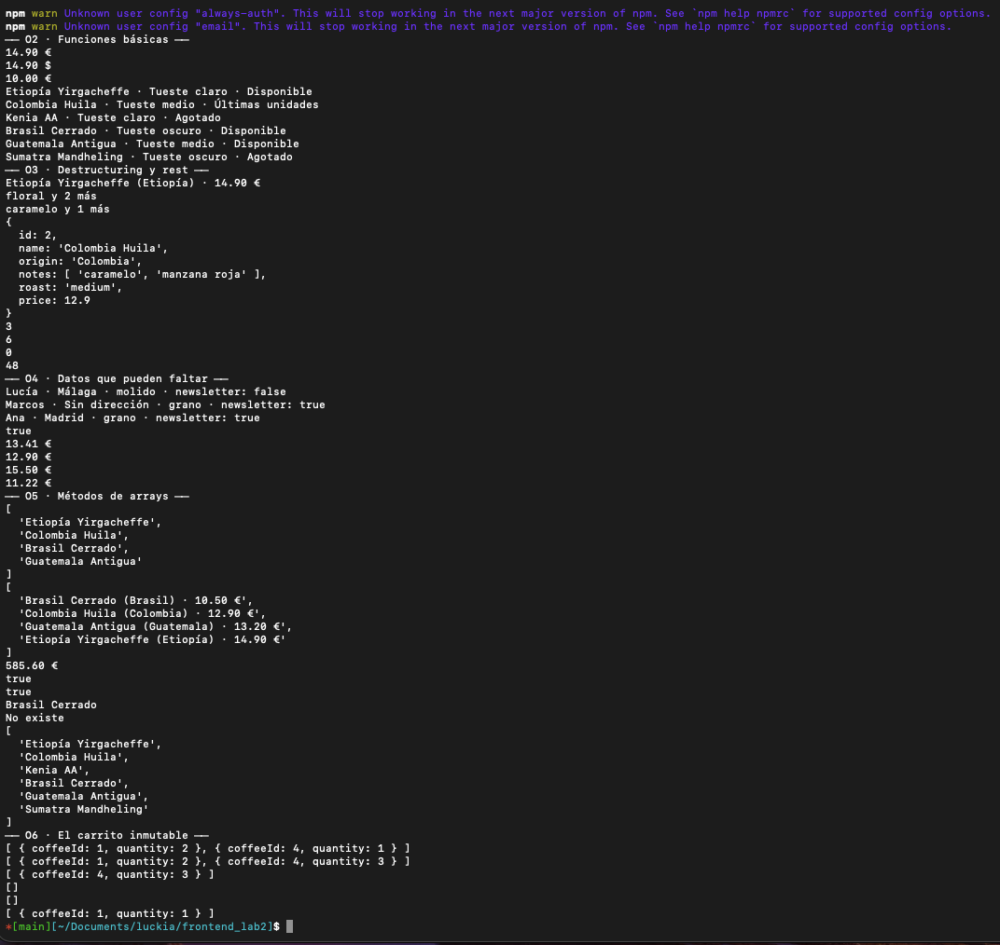
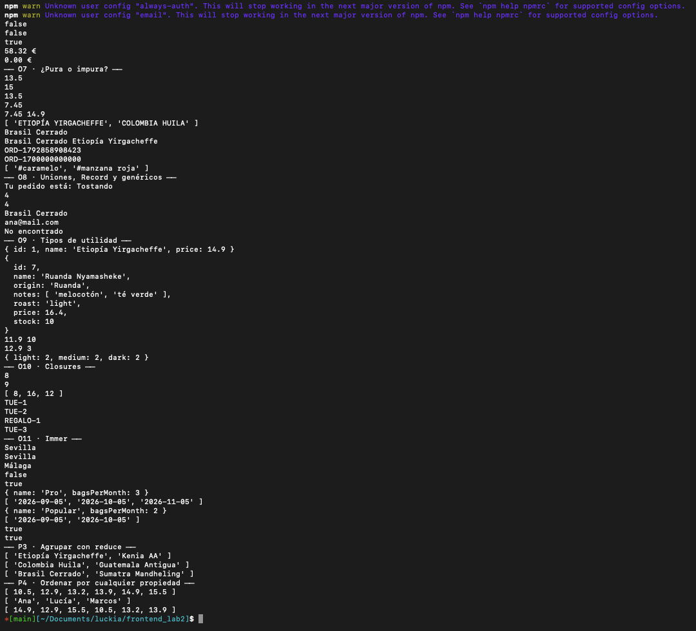

# Laboratorio · Módulo 02 · JavaScript y TypeScript

Katas sobre el catálogo de **Tueste** ☕: tipos, funciones, destructuring, `?.` y `??`, TypeScript e inmutabilidad.

## Cómo arrancarlo

```bash
npm install
npm run dev
```

Abrid la página en el navegador y la consola de DevTools (F12 → Console): ahí sale la salida de las katas.

También se puede ver en la terminal, sin navegador:

```bash
npx tsx src/main.ts
```

### Comprobar tipos

Vite no comprueba los tipos, así que:

```bash
npx tsc
```

✅ `npx tsc` sale sin errores (no muestra nada).

### Tests (P1)

```bash
npm test
```

Ejecuta con Vitest los tests de O5 y O6 (`src/*.test.ts`).

## Estructura

```
src/
├── types.ts                 ← O1
├── data.ts                  ← datos de partida
├── o01-tipos.ts … o11-immer.ts   ← obligatorios
├── o05-arrays.test.ts           ← P1
├── o06-carrito.test.ts          ← P1
├── p03-agrupar.ts               ← P3
├── p04-ordenar.ts               ← P4
└── main.ts                      ← importa todas las katas
```

## Captura de la consola

Salida de `npx tsx src/main.ts` en la terminal (la misma que sale en la consola de DevTools con `npm run dev`). Las dos líneas `npm warn` del principio vienen de la configuración global de npm, no del proyecto.

O2 – O6:



O6 (final) – P4:



## Respuestas a 📝 y 🔍

Cada respuesta está también como comentario junto al código.

| Kata | Pregunta | Respuesta |
| --- | --- | --- |
| [O1](src/o01-tipos.ts) | Tres errores a propósito | `Type '"extra"' is not assignable to type 'Roast'.` · `Property 'price' is missing in type '{ ... }' but required in type 'Coffee'.` · `Cannot assign to 'id' because it is a read-only property.` |
| [O2](src/o02-funciones.ts) 🔍 | Quitar un `case` del `switch` | `Function lacks ending return statement and return type does not include 'undefined'.` Sin ese `case`, para ese tueste la función llegaría al final sin `return` y devolvería `undefined`, que no es `string`. |
| [O3](src/o03-destructuring.ts) 📝 | El `...` de `sumAll(...coffees.map(...))` | Es **spread**, no rest: está en la llamada. Despliega el array de stocks en argumentos sueltos; el rest de la definición de `sumAll` los vuelve a recoger en un array. |
| [O4](src/o04-opcionales.ts) 🪤 | `\|\|` en lugar de `??` | Lucía tiene `newsletter: false`. `\|\|` usa el valor por defecto con cualquier falsy, y `false` lo es, así que devuelve `true`. `??` sólo lo usa con `null`/`undefined`. |
| [O5](src/o05-arrays.ts) 🔍 | `sort` en lugar de `toSorted` | En `catalogLabels` el catálogo sigue igual: `sort` muta, pero aquí ordena la copia que acaba de crear `filter`. Si se llama `list.sort(...)` sin el `filter` delante, sí reordena `coffees`. `toSorted` no depende de que haya una copia antes. |
| [O7](src/o07-pureza.ts) | ¿Pura o impura? | 1 impura (lee una variable externa) · 2 impura (muta el argumento) · 3 pura · 4 impura (`sort` muta el argumento) · 5 impura (depende de la hora) · 6 pura: el `push` es sobre un array local que nadie más conoce. |
| [O8](src/o08-uniones-genericos.ts) 🔍 | Borrar `delivered` | `Property 'delivered' is missing in type '{ pending: string; roasting: string; shipped: string; }' but required in type 'Record<OrderStatus, string>'.` |
| [O8](src/o08-uniones-genericos.ts) 🔍 | Tipo de `findById` | `findById(coffees, 4)` → `Coffee \| null`; `findById(customers, 3)` → `Customer \| null`. `T` se infiere de la lista. |
| [O10](src/o10-closures.ts) 📝 | `.map(blackFriday)` sin paréntesis | Pasamos la función como valor y `map` la llama con cada precio; con paréntesis le pasaríamos su resultado. `blackFriday` es pura (sólo lee `rate`, capturado y fijo). `nextOrderId` es impura: modifica `count` y cada llamada devuelve algo distinto. |
| [O11](src/o11-immer.ts) 📝 | ¿Spread o Immer? | Spread para objetos planos o cambios a un nivel. Immer para estado anidado o varios cambios a la vez: dice exactamente qué cambia y no hay ningún spread que olvidar. |

## Checklist

### Obligatorios

- [x] O1 · Tipar el catálogo
- [x] O2 · Funciones básicas
- [x] O3 · Destructuring y rest
- [x] O4 · Datos que pueden faltar
- [x] O5 · Métodos de arrays
- [x] O6 · El carrito inmutable
- [x] O7 · ¿Pura o impura?
- [x] O8 · Uniones, Record y genéricos
- [x] O9 · Tipos de utilidad
- [x] O10 · Closures
- [x] O11 · Immer
- [x] O12 · README + bitácora de IA

### Opcionales

- [x] P1 · Tests con Vitest
- [ ] P2 · Deshacer en el carrito
- [x] P3 · Agrupar con reduce
- [x] P4 · Ordenar por cualquier propiedad
- [ ] P5 · Datos desconocidos con `unknown`
- [ ] P6 · Vuestros propios `map` y `filter`
- [ ] P7 · Modelad los datos de vuestro TFM

### Desafíos

- [ ] D1 · Pintar el catálogo en la landing del módulo 1
- [ ] D2 · Uniones discriminadas
- [ ] D3 · Medir el coste de la inmutabilidad
- [ ] D4 · Un pedido como en React (reducer con Immer)
- [ ] D5 · Vuestro propio `reduce`

## 🤖 Bitácora de IA

**Herramienta:** Claude Code (Claude Opus 5.5), dentro del propio repositorio. Le di como contexto los apuntes del módulo (`02-lenguajes/`) y las reglas del laboratorio: TypeScript 6 estricto, sin `any` ni `var`, sin mutar la entrada, `import type` por `verbatimModuleSyntax` y uniones de literales en lugar de `enum`.

Cada kata la revisé ejecutándola (`npx tsx src/main.ts`) contra la salida esperada y con `npx tsc`.

### O5 · `catalogLabels` duplicaba `availableCoffees`

#### Prompt

"`catalogLabels(list: Coffee[]): string[]` → los disponibles, ordenados por precio de menor a mayor y convertidos con `coffeeCard`. En una sola cadena: filter → toSorted → map."

#### Qué me dio

Una cadena que empezaba con su propio `filter`, copiando la condición de `availableCoffees`, que estaba justo encima en el mismo fichero:

```ts
export const catalogLabels = (list: Coffee[]): string[] =>
  list
    .filter((coffee) => coffee.stock > 0)
    .toSorted((a, b) => a.price - b.price)
    .map(coffeeCard);
```

#### Qué corregí y por qué

Cambié el `filter` por una llamada a `availableCoffees`:

```ts
export const catalogLabels = (list: Coffee[]): string[] =>
  availableCoffees(list)
    .toSorted((a, b) => a.price - b.price)
    .map(coffeeCard);
```

La regla de "qué café está disponible" tiene que estar en un solo sitio. Con la condición duplicada, si mañana cambia (por ejemplo, reservar un mínimo de bolsas), habría que acordarse de cambiarla en dos funciones, y si se olvida una, el catálogo enseñaría cafés que `availableCoffees` considera agotados. La cadena sigue siendo filter → toSorted → map: el `filter` está dentro de `availableCoffees`.
